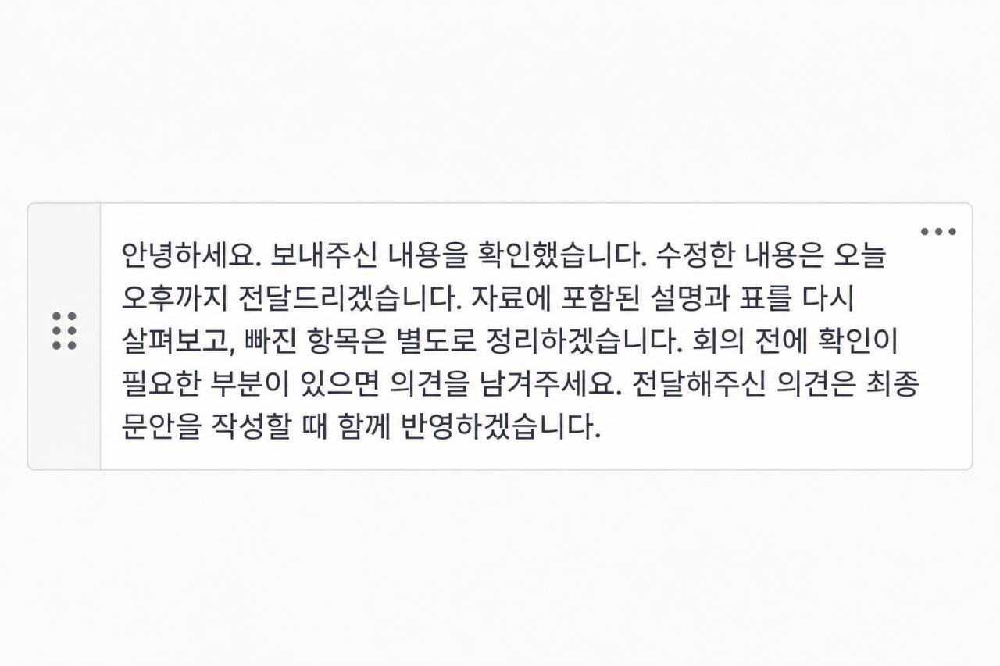
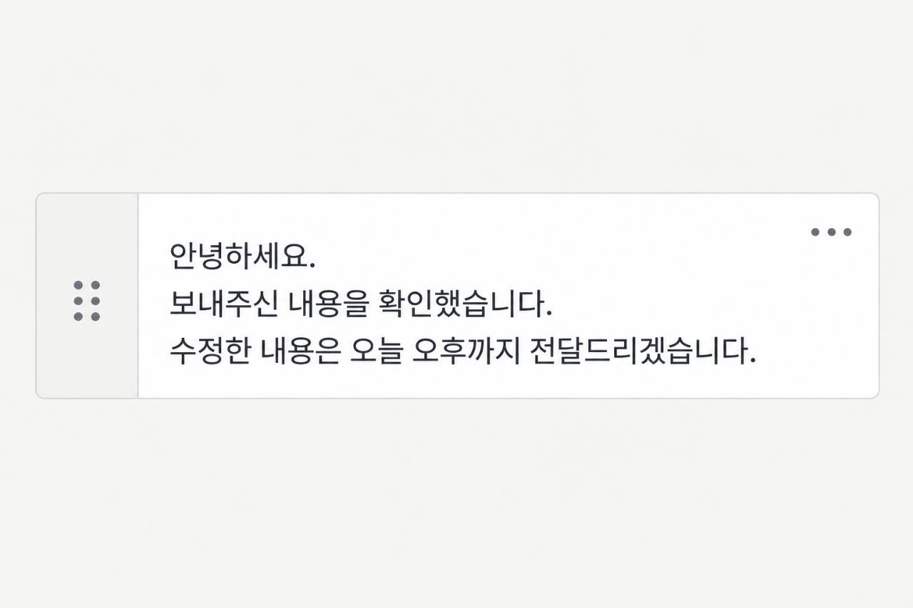
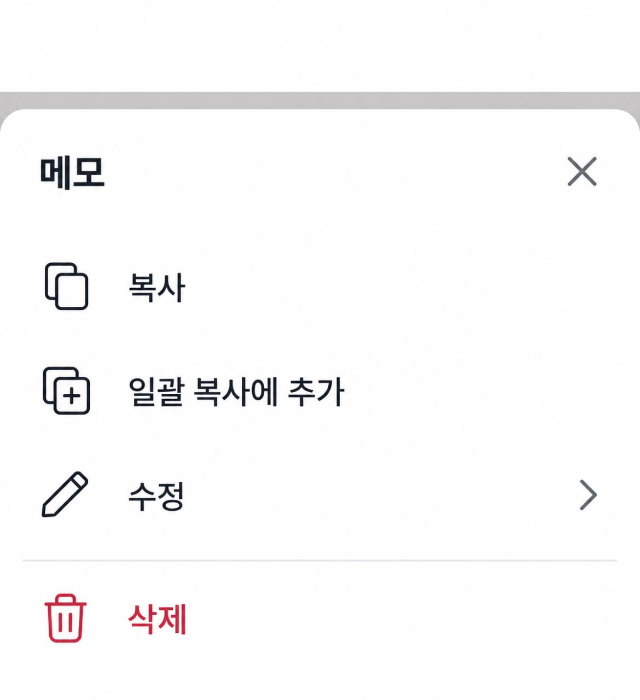
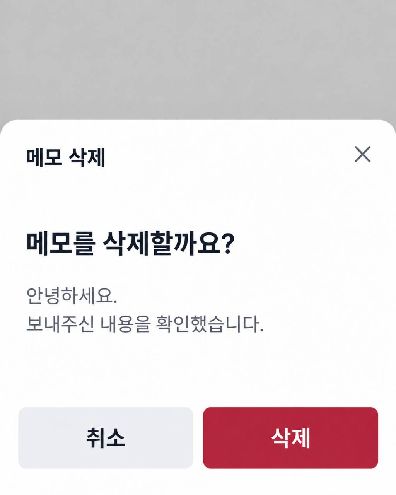
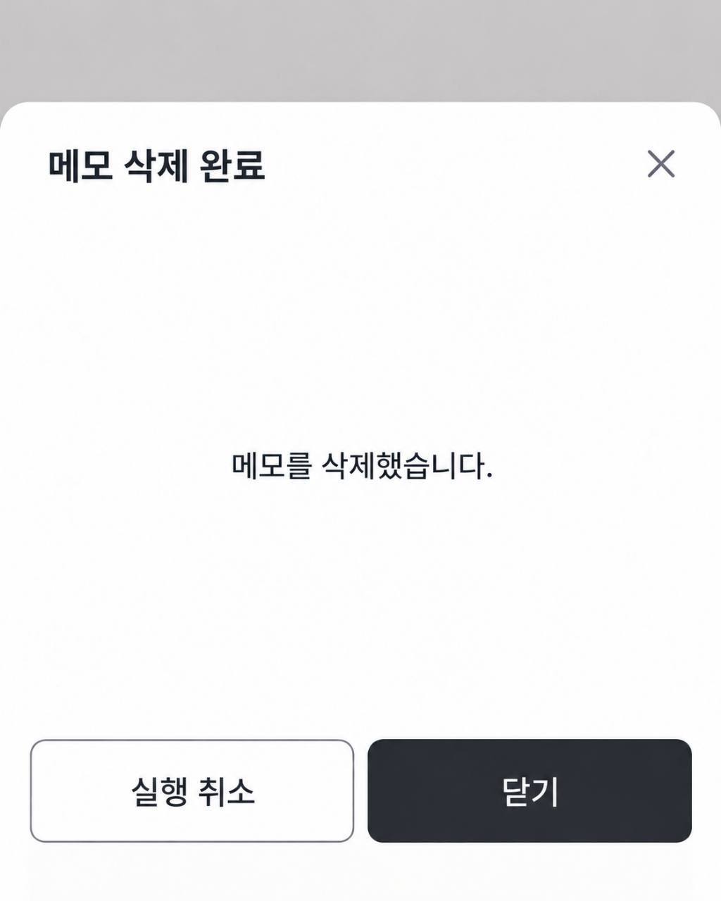
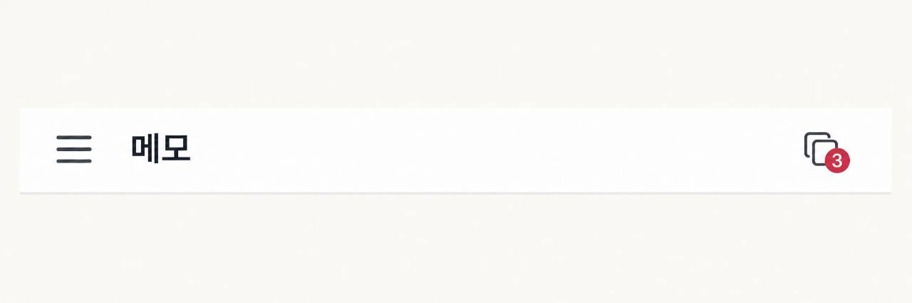

# 모바일 메모와 고정 높이 바텀 시트

선택된 메모 구성과 메뉴, 삭제 확인 및 완료 시트는 현재 애플리케이션 구조에서 구현할 수 있다. 본문과 분리된 핸들 및 더보기를 마련하고, 삭제 처리 중과 완료 상태를 같은 시트에 유지해야 한다. 시트 높이 480 CSS px과 누름 테두리 3 CSS px은 실제 모바일 화면에서 비교할 초기 제안이다.

이 문서는 [모바일 메모 구성과 조작](../requirements.md#확정된-모바일-메모-구성과-조작), [고정 높이 시트와 삭제](../requirements.md#고정-높이-바텀-시트와-삭제)에 필요한 시안 및 적용 조건을 기록한다. 시각 자료와 코드를 확인한 날짜는 2026년 10월 18일이다. 생성 시안은 실행 화면의 동작이나 계산된 CSS 값을 입증하지 않는다.

## 메모 시안에서 확인한 구성

긴 본문과 짧은 본문 모두 얇은 테두리의 메모 안에 왼쪽 핸들 영역, 본문과 오른쪽 위 더보기가 있다. 핸들 영역은 옅은 중립색이며 세로 구분선으로 본문과 나뉜다. 본문은 제목이나 별도 상태 행 없이 표시된다.

두 이미지는 메모 한 개를 보여주는 생성 시안이다. 실제 스마트폰 화면 너비나 글자 크기를 확인할 기준이 없으므로 이미지의 픽셀 비율을 CSS 크기로 그대로 환산하지 않는다. 본문의 줄바꿈, 더보기와 겹치지 않는 여백과 왼쪽 핸들 구성을 채택하고, 기존 미리보기 높이 및 320 CSS px의 가독성은 실제 화면에서 함께 확인한다.

## 메뉴와 삭제 시안

메뉴는 제목과 닫기 아래에 복사, 일괄 복사에 추가와 수정을 두고 구분선 아래에 삭제를 표시한다. 삭제 확인은 대상 미리보기와 취소 및 삭제를, 완료는 실행 취소와 닫기를 제공한다.

시트 시안마다 배경과 시트가 차지하는 비율이 다르다. 단계마다 높이가 달라지는 모습은 재현하지 않고, [확정된 고정 높이 조건](../requirements.md#고정-높이-바텀-시트와-삭제)에 맞춰 같은 틀 안에 내용을 배치한다. 삭제 완료 후 시트 유지와 닫기 전까지 실행 취소는 확정된 동작이다.

## 현재 코드와 연결할 부분

현재 기반은 Next.js 16.3.3, React 19.2.8과 Tailwind CSS 4.3.3이다.

- [모바일 메모](../../../../apps/notes/src/_pages/notes/ui/mobile-note-card.tsx)는 본문 버튼과 오른쪽 수정 링크로 구성된다. 왼쪽 핸들과 메모 더보기 시트는 아직 없다. 기존 본문 미리보기와 상세 편집을 유지하면서 시안의 조작 영역을 추가할 수 있다.
- [모바일 길게 누르기](../../../../apps/notes/src/_pages/notes/model/use-mobile-note-long-press.ts)는 500ms와 이동 10 CSS px을 사용하고 손을 뗄 때 길게 누르기를 실행한다. 현재 의미는 개별 복사이므로 새 의미인 일괄 복사 추가와 누름 표시를 구분해 반영해야 한다.
- [모바일 목록](../../../../apps/notes/src/_pages/notes/ui/mobile-notes-workspace.tsx)은 별도 수집 상태와 하단 초기화 및 다음을 사용한다. 현재 `clickCount`는 입력 누계여서 확인 화면의 복제 및 삭제 이후 실제 항목 수와 다를 수 있다. 새 헤더는 현재 작업의 항목 수를 보여줘야 한다.
- [확인 페이지 이동](../../../../apps/notes/src/_pages/notes/model/use-mobile-batch-copy-navigation.ts)은 현재 작업을 확인 단계로 바꾼 뒤 주소를 이동한다. 화면 단계를 줄이더라도 먼저 접수한 추가, 순서 및 실패 복구는 보존해야 한다.
- [공통 액션 시트](../../../../apps/notes/src/shared/ui/action-sheet/index.tsx)는 네이티브 dialog를 사용하며 현재 외곽 높이는 내용에 따라 정해진다. 모달 표시와 닫기 동작은 재사용할 수 있지만 고정 높이, 단계별 내용과 삭제 후 수명은 별도로 정해야 한다. 일괄 복사 항목 시트의 조작 후 자동 닫힘까지 메모 시트에 가져오지 않는다.
- [기존 메모 삭제 조작](../../../../apps/notes/src/_pages/notes/model/use-note-card-actions.ts)은 삭제 후 포커스를 목록으로 옮기고 5초 토스트에서 복원한다. 모바일 시트가 열린 상태에서는 포커스와 삭제한 메모의 복원 기회를 시트 안에 유지해야 한다. 원본 메모의 제거가 시트를 닫는 조건이 되지 않아야 한다.

새 시트의 높이 유지, 실제 터치 판정과 페이지 이동 속도는 아직 실행 증거가 없다.

## 헤더의 항목 수 배지

항목 수는 헤더 오른쪽의 일괄 복사 아이콘 오른쪽 아래에 겹친 붉은 원형 배지 안에 흰색 숫자로 표시한다. 시안의 3은 현재 작업의 항목 수를 뜻하며 저장 목록의 수나 누적 입력 횟수가 아니다.

이 시안과 [확정된 표시 조건](../requirements.md#확정된-모바일-메모-구성과-조작)에 따라 항목이 하나 이상일 때만 배지를 표시한다. 처음부터 항목이 없거나 초기화 후 0개가 되면 숫자와 붉은 배경을 모두 숨긴다. 아이콘 링크 자체는 유지하고, 다시 항목을 추가하면 같은 위치에 배지를 표시한다.

붉은 배경의 정확한 색과 배지 지름은 이미지에서 CSS 값으로 확정하지 않는다. [WCAG 글자 대비 설명](https://www.w3.org/WAI/WCAG22/Understanding/contrast-minimum.html)에 따라 숫자와 배경은 일반 문구의 4.5:1 기준을 확인하고, [현재 디자인 체계](../../../../apps/notes/DESIGN.md#색과-표면)의 흰색 글자 사용 조건을 유지한다. 여러 자리 수와 200% 글자 확대에서도 숫자가 잘리지 않는지 확인한다. 배지의 표시 여부와 무관하게 링크의 접근 가능한 이름으로 현재 항목 수를 전달한다.

## 높이와 조작 영역의 초기 제안

기준 높이는 safe area를 포함해 480 CSS px으로 비교한다. 브라우저 도구 모음이 보이는 안정적인 표시 높이에서 상단 여백 16 CSS px을 뺀 값을 상한으로 삼고, 같은 크기의 화면에서는 메뉴부터 삭제 완료 및 오류까지 이 외곽을 유지한다. 회전이나 실제 표시 영역 크기가 바뀌면 그 높이에 맞춰 시트 크기를 다시 정한다.

기본 글자 크기에서 제목 영역 64 CSS px, 메뉴 행 네 개에 각 56 CSS px, 단계 하단 버튼과 여백 80 CSS px, 나머지 여백 및 safe area에 약 112 CSS px을 배분하면 480 CSS px 안에서 비교할 수 있다. 모든 단계가 모든 영역을 채울 필요는 없으며 메뉴 단계에는 빈 하단 버튼 행을 만들지 않는다. 이 배분은 시안 계측값이나 보편적인 권장 높이가 아니다.

[CSS Values and Units Level 4의 표시 영역 단위](https://drafts.csswg.org/css-values-4/#viewport-relative-lengths)는 `svh`가 브라우저 UI가 펼쳐진 표시 영역을 기준으로 안정적인 값을 사용하고, `dvh`는 스크롤 중에도 달라질 수 있다고 설명한다. 따라서 단계별 내용에 따른 높이와 브라우저 UI의 높이 변화를 구분해서 확인한다. 이 문서는 CSS 표준 초안의 단위 정의를 참고하며 480 CSS px의 근거로 사용하지 않는다.

[CSS 환경 변수의 safe area](https://www.w3.org/TR/css-env-1/#safe-area-insets)는 중요한 내용을 화면의 안전한 영역 안에 배치하기 위한 inset을 정의한다. 시트 외곽에 포함한 하단 여백과 실제 버튼 위치를 함께 확인하며, 여백이 추가돼 총높이가 단계마다 커지지 않게 한다.

긴 미리보기와 200% 글자 확대는 본문 스크롤로 처리하는 안을 우선 비교한다. 제목과 닫기, 하단 조작은 본문과 분리하고, 짧은 가로 화면에서 이 고정 영역 자체가 맞지 않으면 확대된 문구를 줄이거나 잘라 숨기지 않고 배치를 다시 정한다.

누름 테두리는 붉은색 3 CSS px을 초기 후보로 비교한다. 누르기 전후의 본문 너비와 줄바꿈은 유지하고, 누르는 동안의 표시와 일괄 복사에 담긴 표시 및 키보드 포커스를 구별한다. 본문과 분리한 핸들 및 더보기의 조작 영역은 각각 44 CSS px 이상을 초기 후보로 확인한다.

## 입력, 삭제와 이동에서 확인할 조건

[WCAG의 Pointer Cancellation 설명](https://www.w3.org/WAI/WCAG22/Understanding/pointer-cancellation.html)은 손을 뗄 때 실행하고 그 전에 취소할 수 있게 하는 방식을 설명한다. 짧은 터치와 길게 터치는 같은 입력에서 하나만 완료하고, 스크롤, 카드 밖 놓기와 취소에서 추가나 복사를 실행하지 않는 안을 확인한다. 타이머가 지났다는 이유만으로 손을 누른 채 여러 항목을 반복 추가하지 않는다.

[WAI-ARIA 모달 대화상자 지침](https://www.w3.org/WAI/ARIA/apg/patterns/dialog-modal/)은 열린 대화상자 안의 포커스 이동과, 닫을 때 실행 요소가 사라졌다면 다른 적절한 요소로 포커스를 옮기는 조건을 설명한다. 삭제 확인과 완료에서 제목 및 현재 단계를 알리고, 삭제된 메모의 더보기를 포커스 복귀 대상으로 계속 참조하지 않는다. 삭제나 복원 실패는 같은 단계 가까이에 남기고 재시도 중 중복 실행을 막는다.

[Next.js의 링크와 탐색 안내](https://nextjs.org/docs/app/getting-started/linking-and-navigating)는 링크 사전 로딩과 로딩 UI가 이동 반응에 미치는 영향을 설명한다. 헤더에서 확인 페이지로 바로 이동하는 변경은 수집 모드와 다음 버튼을 거치는 조작을 줄인다. 전송 및 저장 대기까지 사라졌다는 의미는 아니며 Cloudflare 배포의 첫 이동과 반복 이동에서 별도로 확인한다.

항목이 0개일 때 숫자와 배지를 숨기는 것은 확정된 표시 조건이다. 아이콘 링크에서 빈 현재 작업 확인 화면을 여는 안은 초기 제안으로 둔다. 저장된 목록을 현재 작업처럼 섞어 표시하지 않으며 확인 화면에서 목록으로 돌아갈 수 있어야 한다. 현재 작업 초기화와 명시적 취소, 뒤로가기 및 새로고침은 기존 자료 보존 조건과 대조한다.

모바일 초기 화면의 핸들은 시각 구성으로 정해졌지만 드래그로 놓을 대상과 적용할 변경은 미정이다. [WCAG Dragging Movements](https://www.w3.org/WAI/WCAG22/Understanding/dragging-movements.html)의 단일 pointer 대안도 그 의미를 정한 뒤 비교한다. 이 선택은 U47에 남기며 개별 복사와 시트의 문서화를 막는 조건으로 확대하지 않는다.

U46에서는 320 및 390 CSS px, 짧은 화면과 가로 화면, 200% 글자 확대에서 비교할 시안과 구현 후 확인 조건을 정한다. 실제 구현 완료에는 같은 시트 높이와 모든 조작의 접근 여부를 확인한 실행 증거가 필요하다. 삭제 뒤 5초 이상 대기한 실행 취소, 삭제 및 복원 실패 후 재시도, 현재 항목 수 변경과 뒤로가기, 연속 추가 직후의 확인 페이지 진입을 포함한다. 문서와 생성 시안만으로 실제 동작의 통과를 기록하지 않는다.
